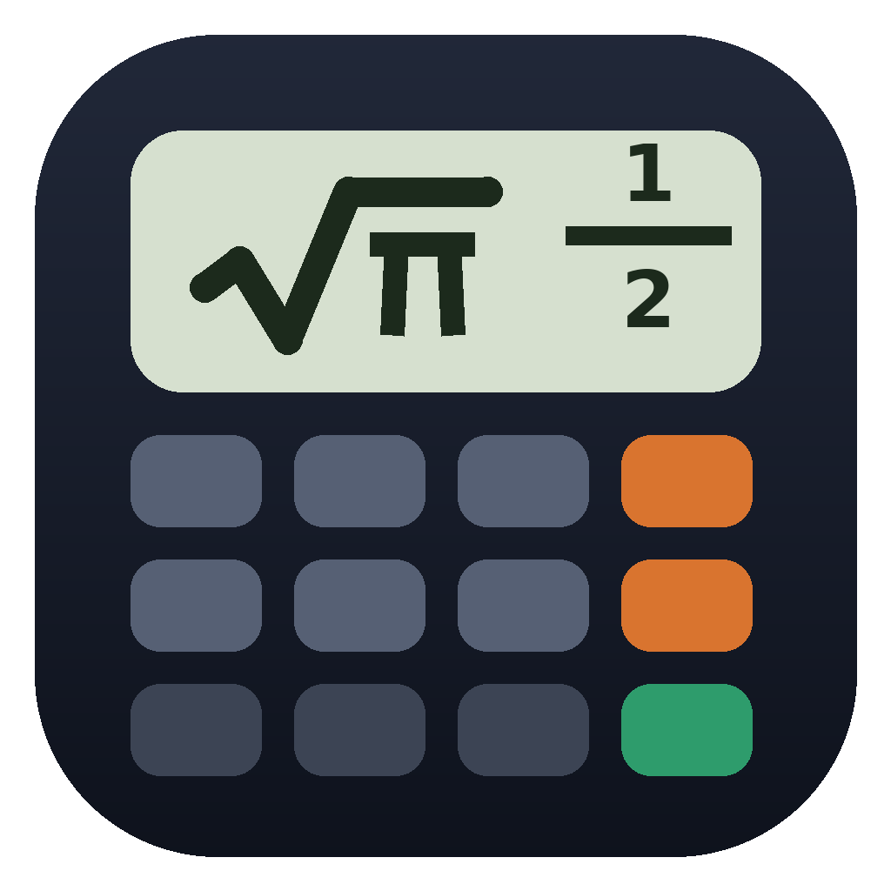

<div align="center">



# SciCalc

**A free scientific calculator for Windows that shows real math: fractions, roots and π.**

[](https://scicalcofficial.netlify.app)
[](https://github.com/samirjod12/SciCalc/releases/download/Fix/SciCalc.exe)

[](https://github.com/samirjod12/SciCalc/releases/tag/Fix)
[](https://github.com/samirjod12/SciCalc/releases)
[](https://github.com/samirjod12/SciCalc/stargazers)
[](#installation)
[](https://github.com/samirjod12)

[**Website**](https://scicalcofficial.netlify.app) · [**Download**](https://github.com/samirjod12/SciCalc/releases/download/Fix/SciCalc.exe) · [**Releases**](https://github.com/samirjod12/SciCalc/releases) · [**Report a bug**](https://github.com/samirjod12/SciCalc/issues)

</div>

---

## About

SciCalc is a free and open-source scientific calculator for Windows. Answers appear the way you would write them on paper: stacked fractions like ½, roots like 2√2 and √2⁄2, and π forms, with a one-key switch to decimals.

Teachers can enlarge the window for a projector, and students can copy results straight into their homework.

## Features

- **Natural results:** exact fractions, roots and π. Press `S⇔D` for decimals.
- **Trigonometry:** sin, cos, tan and inverses in degrees, radians or gradians.
- **Calculus:** definite integrals `∫(X^2,0,1)` and derivatives `d/dx(X^3,2)`.
- **Math functions:** powers, roots, log, ln, factorial, nCr, nPr, percent and ×10ˣ.
- **Memory:** `Ans`, `M`, `M+` and `M−`.
- **History:** recall earlier entries with the Up and Down arrow keys.
- **Copy and paste:** copy the expression, the result, or both.
- **Resizable window:** the display and keys scale with the window. Use `Ctrl +` and `Ctrl −` to change text size.
- **Keyboard friendly:** type expressions directly. `Enter` calculates and `Esc` clears.
- **Portable:** one file, no installer.

## Installation

1. Download **[SciCalc.exe](https://github.com/samirjod12/SciCalc/releases/download/Fix/SciCalc.exe)** from the latest release.
2. Double-click the file to run it.

> **Windows SmartScreen warning?** SciCalc is a new, unsigned program. Click **More info → Run anyway**.

**Requirements:** Windows 10 or 11 (64-bit). You do not need Python.

## Quick guide

| You type | You get |
|---|---|
| `1÷3+1÷6` | ½ |
| `√(8)` | 2√2 |
| `sin(45)` | √2⁄2 |
| `5nCr2` | 10 |
| `∫(X^2,0,1)` | ⅓ |
| `d/dx(X^3,2)` | 12 |

Tip: press `2nd` first to use the gold function on a key, for example `2nd` + `sin` for sin⁻¹.

## Run or build from source

You need Python 3.9 or newer.

```bash
python scicalc.py
```

To build `SciCalc.exe` yourself, double-click `build_exe.bat`. The file appears in the `dist` folder. This repository also builds the program automatically with GitHub Actions (see `.github/workflows/build.yml`).

## Project files

| File | Purpose |
|---|---|
| `scicalc.py` | The calculator window |
| `scicalc_engine.py` | The math engine |
| `scicalc.ico` | Program icon |
| `build_exe.bat` | Builds `SciCalc.exe` on Windows |

## Links

- 🌐 Website: <https://scicalcofficial.netlify.app>
- 📦 Repository: <https://github.com/samirjod12/SciCalc>
- 👤 Author: [@samirjod12](https://github.com/samirjod12)

## Contributing

Bug reports and ideas are welcome. Open an [issue](https://github.com/samirjod12/SciCalc/issues) or send a pull request. This project is still being improved.

## License

See the [LICENSE](LICENSE) file.
